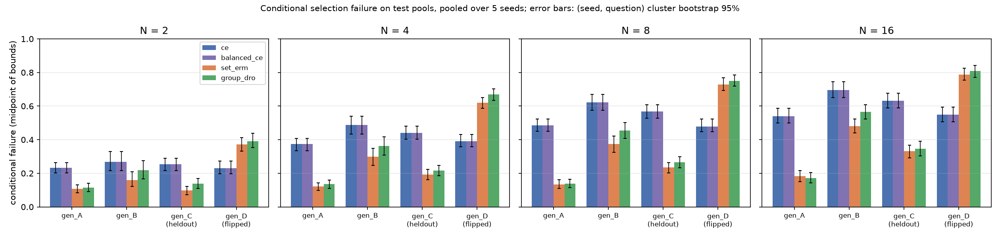

# Process Verifier Shift

A mathematical verifier can recognize many valid reasoning steps and still choose the wrong solution from a pool that contains a correct answer. Selection depends on the highest-scoring error, so increasing the pool or changing its generator can expose behavior that average step accuracy misses.

This repository studies that gap through conditional selection-risk training. It combines a causal process scorer with candidate-set supervision and compares uniform group weighting with group distributionally robust optimization (DRO). Frozen candidate caches keep generation separate from verification. The implementation connects a mathematical objective, memory-conscious backpropagation, and a controlled experiment on transfer under generator and pool-size shifts.

The included study uses synthetic arithmetic and a small causal transformer. A separate Hugging Face/LoRA backend supports the same scoring and training interface for pretrained-model experiments.



## From step labels to a selection objective

Process labels and final-answer labels answer different questions. A trajectory can make an early error and repair it, or contain a locally correct calculation that propagates an earlier mistake. Copying final correctness onto every step would erase that distinction. The data pipeline keeps the two supervision sources separate.

For question $x$ and candidate $i$, the scorer reads only the prefix through step $t$. Its minimum step logit becomes the candidate score:

$$
s_i = \min_t h_\theta(x, r_{i,1:t}), \qquad
p_i = \frac{\exp(s_i/\tau)}{\sum_j \exp(s_j/\tau)}.
$$

Let $z_i$ indicate final-answer correctness and $A$ denote the presence of at least one correct candidate. The soft selection loss is the probability mass assigned to incorrect candidates:

$$
\ell_\tau = \sum_i (1-z_i)p_i, \qquad
R_g(\theta)=\mathbb{E}[\ell_\tau\mid g,A], \qquad
J(\theta,q)=\lambda L_{\mathrm{step}}+\sum_{g\in G}q_gR_g(\theta).
$$

Groups are generator × actual pool size. Conditioning isolates errors a verifier could avoid: an all-incorrect pool contributes to coverage and overall accuracy, but cannot supply a correct selection target. All-correct pools contribute zero selection loss.

| Objective | Training signal |
|---|---|
| Step CE | Binary cross-entropy on annotated steps |
| Balanced CE | Step CE with inverse-frequency class weights |
| Set ERM | Step CE plus equally weighted conditional group risks |
| Group DRO | Step CE plus adaptively weighted conditional group risks |

DRO updates group weights by exponentiated gradient. Each iteration samples one eligible question per group, updates model parameters using the current weights, then updates the weights for the next iteration. The candidate aggregation rule, caches and model initialization are matched across objectives. See [the objective implementation](src/prmshift/objectives.py) and [training loop](src/prmshift/train.py).

## Backpropagation through a candidate pool

Retaining an autograd graph for every prefix of every candidate can dominate activation memory. The scorer instead uses the analytical derivative

$$
\frac{\partial\ell_\tau}{\partial s_i}
=\frac{p_i}{\tau}\big[(1-z_i)-\ell_\tau\big].
$$

A first pass finds each candidate's minimum-scoring step without retaining graphs. A second pass recomputes only that prefix and immediately backpropagates its weighted derivative. For a fixed minimizing branch this is the chain-rule gradient; ties use the first minimizer, a valid subgradient. Dropout is disabled so the two passes evaluate the same function.

[The implementation](src/prmshift/model.py) bounds retained activations by processing one selected prefix at a time, at the cost of repeated forward passes. Training reports count those tokens separately from diagnostic and validation passes. [The gradient test](tests/test_model_and_training.py) compares every parameter gradient with ordinary full-graph autograd, alongside causal-attention, checkpoint and resume checks.

## A controlled test of transfer

The experiment constructs three-operand arithmetic questions with distinct train, validation and test splits: 300, 60 and 200 questions per seed. Every question–generator pair has 16 candidates. One fixed permutation supplies nested pools, with sizes 2, 4 and 8 during training and an additional size 16 at test time.

A first-step suffix, ` (verified)`, carries a generator-dependent correlation with final correctness. Training generators have positive associations; test generators preserve or reverse the association. Step supervision contains exactly balanced cue × correctness cells, so the step-only objectives see the suffix without receiving a cue–label correlation. Early errors, propagated errors and repaired trajectories keep process labels distinct from outcome labels.

Five seeds compare all four objectives using identical caches within each seed. The scorer has one layer, width 32 and four attention heads; each objective trains for 2,000 iterations. [The generator and its tests](src/prmshift/synthetic.py) make the cue rule explicit; [the experiment checks](tests/test_cue_experiment.py) verify its contingency tables, arithmetic labels and nested pools.

Conditional selection failure, pooled over pool sizes and seeds; lower is better:

| Objective | Same-direction held-out generator | Reversed-cue generator |
|---|---:|---:|
| Step CE | 0.492 [0.458, 0.525] | 0.427 [0.398, 0.463] |
| Balanced CE | 0.492 [0.458, 0.525] | 0.427 [0.398, 0.463] |
| Set ERM | 0.224 [0.197, 0.249] | 0.647 [0.621, 0.676] |
| Group DRO | 0.251 [0.226, 0.278] | 0.675 [0.647, 0.704] |

Values are midpoints of identification bounds, with 95% intervals from a `(seed, question)` cluster bootstrap. CE and balanced CE coincide because step supervision is exactly class-balanced. Selection supervision improves performance when the cue association is preserved and reverses that advantage when the association flips. Reweighting observed groups does not remove the shortcut: the reversed association is absent from those groups.

This result motivates separating robustness across observed groups from transfer to a new generator. [All group metrics](results/cue-study/tables/metrics.csv) and [aggregate results](results/cue-study/aggregate.json) retain both directions of the comparison, including coverage, answer accuracy and margins.

## Measurement and implementation checks

The evaluator reports candidate coverage, conditional failure and overall accuracy together. Unknown answers receive identification bounds rather than being counted as incorrect. Resampling keeps each question's related generator and pool-size outcomes together. If one candidate exceeds the context limit, evaluation excludes the whole question–generator cache and records the denominator change.

Problem hashes prevent split leakage; checkpointed training question IDs preserve that check after files move. Cached generation records model revisions and input hashes. The 38-test suite covers these contracts, official annotation branches, group-weight updates, metric identities and local HF/LoRA training and reload behavior. The HF integration test uses a locally initialized model and requires no downloaded weights.

[Research design](docs/research-design.md) develops the risk identities, derivation and experimental choices. [Experiment notes](docs/experiments.md) specify the recorded settings and output files.

## Run the experiments

Use Python 3.11 or later, from the repository root:

```bash
python -m venv .venv
source .venv/bin/activate
python -m pip install -e '.[plots,test]'
python -m pytest -q
python scripts/run_tiny.py --iterations 30
python scripts/export_metrics.py
```

The CPU example writes checkpoints, pool outcomes and metrics to `results/tiny_comparison/`. To reproduce the cue study:

```bash
python scripts/run_cue.py --seeds 2026 2027 2028 2029 2030 \
  --iterations 2000 --validate-every 20 --test-questions 200 \
  --bootstrap 300 --threads 4 --parallel 3
```

Install `.[hf,plots,test]` for the HF backend. [The pretrained-model workflow](docs/pretrained-workflow.md) connects PRM800K conversion, fixed annotation budgets, frozen Qwen/DeepSeek candidate caches, LoRA scoring and ProcessBench evaluation. These configurations are separate from the synthetic results reported above.

## Data and attribution

Synthetic data are generated locally. Raw datasets, model weights and candidate caches are excluded from version control. Four small PRM800K parser fixtures retain mathematical content and annotation branches with identifying metadata removed; [their notice](tests/fixtures/NOTICE.md) records provenance and the upstream license.

Data and models retain their source terms: [PRM800K](https://github.com/openai/prm800k), [MATH-500](https://huggingface.co/datasets/HuggingFaceH4/MATH-500), [ProcessBench](https://huggingface.co/datasets/Qwen/ProcessBench), [Qwen2.5-Math](https://huggingface.co/Qwen/Qwen2.5-Math-1.5B), and [DeepSeek-Math](https://huggingface.co/deepseek-ai/deepseek-math-7b-instruct).
